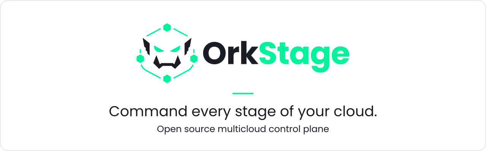
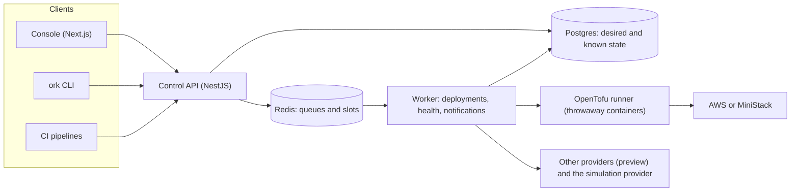

<h1 align="center">
  <picture>
    <source media="(prefers-color-scheme: dark)" srcset=".github/assets/banner-dark.svg">
    <source media="(prefers-color-scheme: light)" srcset=".github/assets/banner-light.svg">
    
  </picture>
</h1>

<p align="center">
  <b>Describe an environment once, place each resource on the cloud, account and region that fits it, review the plan and the cost, and let OrkStage apply it with OpenTofu and keep watch.</b>
</p>

<p align="center">
  <a href="LICENSE"></a>
  <a href="https://github.com/orkstage/orkstage/actions/workflows/ci.yml"></a>
  <a href="https://orkstage.io/docs"></a>
</p>

<p align="center">
  <a href="#quickstart">Quickstart</a> |
  <a href="https://orkstage.io/docs">Documentation</a> |
  <a href="docs/ARCHITECTURE.md">Architecture</a> |
  <a href="docs/ROADMAP.md">Roadmap</a> |
  <a href="https://github.com/orgs/orkstage/discussions">Discussions</a>
</p>

## What it is

OrkStage is an open source multicloud control plane for platform teams that run many copies of
the same application stack: one per customer, team or stage. An **instance** is a complete
environment (API, workers, Postgres, cache, queue, object storage, ingress, DNS), and every
resource in it is placed on its own, so one instance can run its API on AWS, its database on
Azure and its storage on OCI.

- **Templates, not tickets.** A versioned, provider neutral template describes the environment.
  Edit it as YAML or in the visual builder; published versions are immutable.
- **Placement per resource.** Templates declare slots such as `primary` and `data`. Each instance
  binds every slot to a cloud target and region, so the same template runs on one AWS account or
  across providers.
- **Plan before apply.** Capability checks, policies, an approximate monthly cost and a real
  `tofu plan` per resource. Deletions or replacements in production wait for approval.
- **OpenTofu underneath.** One isolated state per resource, runs in throwaway containers, a
  dependency graph executed in parallel, retries of transient failures, and retry of failed
  resources only. No secrets in state.
- **Operate what you deployed.** Health checks, drift detection, automated incidents, private
  status pages, email and console notifications, and an append only audit log.
- **Automate it.** Scoped API keys, signed webhooks, a CI intake endpoint, and the `ork` CLI that
  turns existing Terraform, CloudFormation, Kubernetes or Compose projects into templates.

### Status

| Area | State |
|---|---|
| AWS | **Real.** Provisioned with OpenTofu, locally against [MiniStack](https://ministack.org) or in your account through a cross account role. |
| Azure, Google Cloud, OCI, DigitalOcean, Vultr, CoreWeave, Magalu Cloud | **Preview.** Adapters and OpenTofu modules covered by tests and `tofu validate`, not yet proven on live accounts. Off by default behind a feature flag per provider (`PROVIDER_<NAME>`). |
| Vercel, Render, Supabase | **Preview.** Platform adapters through their APIs, same flags. |
| Simulation provider | Imitates any provider without an account, for demos, tests and rehearsals. Simulated resources are labeled everywhere. |
| `ork` CLI | **Preview.** Releases for Linux, macOS and Windows with install scripts (`curl -fsSL https://orkstage.io/install.sh \| sh`); signed once the signing certificates are configured. |
| Enterprise features | Audit export is available with a license key; the rest is planned. See [docs/OPEN_CORE.md](docs/OPEN_CORE.md). |

What is still open is in [docs/ROADMAP.md](docs/ROADMAP.md).

## How it works



The API records intent and enqueues work; it never calls a cloud itself. The worker compiles the
template into a resolved plan (placement, capabilities, connectivity, policies, cost), runs the
dependency graph through provider adapters, and keeps checking health and drift afterwards.
Details: [docs/ARCHITECTURE.md](docs/ARCHITECTURE.md).

A template, shortened from the built in `multicloud-reference`:

```yaml
apiVersion: platform/v1
kind: EnvironmentTemplate
metadata: { name: multicloud-reference, version: 1.0.0 }
spec:
  placements:
    - { name: primary, providers: [aws, mock] }
    - { name: data, providers: [aws, azure, mock] }
  resources:
    - { id: network, type: network }
    - { id: api, type: compute.container-service, implementation: ecs-fargate,
        image: catalog://sample-api, replicas: 2, port: 8080, public: true }
    - { id: database, type: database.postgresql, placement: data, size: small,
        backup: { enabled: true, retentionDays: 7 } }
    - { id: ingress, type: ingress, routes: [{ service: api }] }
  connectivity:
    - { from: api, to: database, protocol: postgres, port: 5432, mode: private-preferred }
```

## Quickstart

The whole platform runs from the [`orkstage-dev`](https://github.com/orkstage/orkstage-dev)
workspace, which brings this repository together with the console and the OpenTofu modules.
Requirements: Git, Docker with Compose v2 and about 6 GB of free memory. No cloud account needed.

```bash
git clone --recurse-submodules https://github.com/orkstage/orkstage-dev.git
cd orkstage-dev
docker compose --profile platform --profile aws-emulator up -d --build --wait
```

| Service | URL |
|---|---|
| Console | http://localhost:3000 |
| Control API and OpenAPI UI | http://localhost:4000/api/docs |
| MiniStack (local AWS) | http://localhost:4566 |
| Mailpit (emails) | http://localhost:8025 |

Sign in with the development login as `admin@example.local` (platform owner),
`operator@example.local` (operator) or `customer@example.local` (customer owner of the Acme
tenant). Open **Acme Staging (local AWS)**, check *Plan & cost*, deploy, and watch OpenTofu create
a VPC, an ALB, RDS Postgres, Valkey, SQS and ECS services in MiniStack.

Stop with `docker compose --profile platform --profile aws-emulator down` (add `-v` to delete the
data). This stack runs in development mode with the Docker socket mounted; it is for local
evaluation only. The [quickstart guide](https://orkstage.io/docs/get-started/quickstart) walks
through the first deployment, and [Connect AWS](https://orkstage.io/docs/self-hosting/connect-aws)
covers real accounts.

### Run from source

Requirements: Node 24+, pnpm 12, Docker.

```bash
cp .env.example .env
pnpm install
pnpm local:up                  # Postgres, Redis and Mailpit in Docker
pnpm build
pnpm db:deploy && pnpm db:seed
pnpm dev                       # API on :4000 and the worker
```

`pnpm local:aws` adds MiniStack. `pnpm test` and `pnpm typecheck` run across the workspace.
To work on the console or the modules at the same time, use the `orkstage-dev` workspace.
The optional adapter contract test against the emulator runs with
`MINISTACK_E2E=1 pnpm --filter @orkstage/cloud-aws test`.

## Repositories

OrkStage is split into focused repositories under the [`orkstage`](https://github.com/orkstage)
organization. This one is the core.

| Repository | What it contains | License |
|---|---|---|
| [`orkstage`](https://github.com/orkstage/orkstage) | Control API, worker, shared packages, Enterprise modules in `ee/` | AGPL-3.0, `ee/` commercial |
| [`orkstage-console`](https://github.com/orkstage/orkstage-console) | Web console (Next.js) | AGPL-3.0 |
| [`orkstage-cli`](https://github.com/orkstage/orkstage-cli) | `ork` CLI and the scan engine (Rust, WebAssembly) | AGPL-3.0 |
| [`orkstage-modules`](https://github.com/orkstage/orkstage-modules) | OpenTofu modules and the runner image | Apache-2.0 |
| [`orkstage-site`](https://github.com/orkstage/orkstage-site) | orkstage.io and the documentation | MIT, content CC BY 4.0 |
| [`orkstage-dev`](https://github.com/orkstage/orkstage-dev) | Meta repository: Docker Compose plus pinned submodules | MIT |

How they depend on each other: [docs/POLYREPO.md](docs/POLYREPO.md).

## Repository layout

```text
apps/api/          Control API: auth, tenancy, CASL, templates, instances, deployments
apps/worker/       Deployment workflow, health monitor, drift checks, notifications
packages/          domain, templates, provisioning, cloud-core, cloud-aws, cloud-mock, iac,
                   authorization, contracts, runtime, database, licensing
infra/local/       Docker Compose for local development (with the MiniStack profile)
infra/docker/      Platform image
infra/aws/         CloudFormation for the deployment role in a customer account
docs/              Architecture, API map, ADRs, roadmap
```

## Documentation

- [Get started](https://orkstage.io/docs/get-started) and [core concepts](https://orkstage.io/docs/get-started/core-concepts)
- [Run OrkStage on your own infrastructure](https://orkstage.io/docs/self-hosting/docker-compose)
- [API reference](https://orkstage.io/docs/developer/api-reference) and [API map](docs/API.md)
- [Architecture](docs/ARCHITECTURE.md), [decisions](docs/adr), [security model](docs/SECURITY.md)

## Contributing

Issues and pull requests are welcome. Read [CONTRIBUTING.md](.github/CONTRIBUTING.md) for the
development setup and checks, and the [code of conduct](https://github.com/orkstage/.github/blob/main/CODE_OF_CONDUCT.md).
Questions go to [Discussions](https://github.com/orgs/orkstage/discussions).

## Security

Do not open public issues for vulnerabilities. Report them privately through
[GitHub Security Advisories](https://github.com/orkstage/orkstage/security/advisories/new) or to
security@orkstage.io. See the [security policy](https://github.com/orkstage/.github/blob/main/SECURITY.md).

## License

OrkStage is open core. Everything in this repository is licensed under the
[GNU AGPL-3.0](LICENSE), except directories named `ee/`, which are under the OrkStage Enterprise
License ([apps/api/src/ee/LICENSE](apps/api/src/ee/LICENSE), draft) and are activated with a
license key (`ORKSTAGE_LICENSE_KEY`). Without a key you run the full Community edition. The
licensing model and the feature split are in [docs/OPEN_CORE.md](docs/OPEN_CORE.md).

"OrkStage" and the OrkStage logo are trademarks of the OrkStage project.
