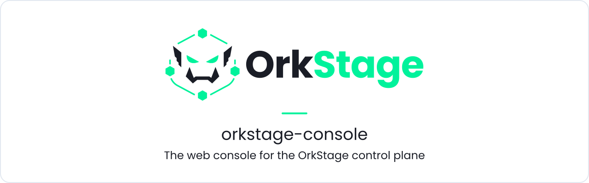
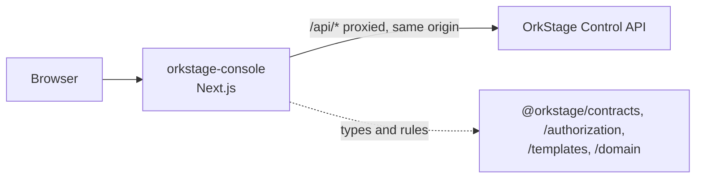

<h1 align="center">
  <picture>
    <source media="(prefers-color-scheme: dark)" srcset=".github/assets/banner-dark.svg">
    <source media="(prefers-color-scheme: light)" srcset=".github/assets/banner-light.svg">
    
  </picture>
</h1>

<p align="center">
  <b>The web console for OrkStage: build templates, place resources across clouds, review plans and cost, deploy, and follow health and incidents from one place.</b>
</p>

<p align="center">
  <a href="LICENSE"></a>
  <a href="https://github.com/orkstage/orkstage-console/actions/workflows/ci.yml"></a>
  <a href="https://orkstage.io/docs/user-guide/console"></a>
</p>

## What it is

A Next.js application that talks only to the OrkStage Control API. It never holds cloud
credentials, and the browser never sees a token: `/api/*` is proxied to the API on the same
origin, so the session cookie stays `httpOnly` and `SameSite=Lax`.

| Area | What you can do |
|---|---|
| Dashboard | Overview of tenants, instances and deployments, with deployment and health trends (ECharts) |
| Templates | Edit YAML with live validation, or use the drag and drop builder on the same document; version, publish, clone; import a draft from existing IaC |
| Instances | Bind placement slots to cloud targets, preview the plan, policies and approximate cost, deploy, upgrade, destroy |
| Deployments | Live steps, a Gantt timeline, the event log, approvals, cancel and retry of failed resources |
| Topology | Diagram of every resource and connection (React Flow), with "Copy as Mermaid" |
| Operations | Health, incidents, private status pages, notifications, audit log |
| Settings | Cloud targets, API keys and webhooks, edition badge |

What the user sees follows the CASL rules the API sends with `/me`; the API remains the
authority for every action.



## Quickstart

The console needs a running Control API. The quickest way to see it is the full stack from the
[core repository](https://github.com/orkstage/orkstage#quickstart), which builds the console and
serves it on http://localhost:3000.

To work on the console itself (Node 24+, pnpm 12), with the API on http://localhost:4000:

```bash
pnpm install
pnpm dev               # http://localhost:3000
pnpm typecheck
pnpm build && pnpm start
```

`API_INTERNAL_URL` sets the API origin (default `http://localhost:4000`).

> **Install status.** This repository depends on `@orkstage/contracts`, `@orkstage/authorization`,
> `@orkstage/templates` and `@orkstage/domain` from GitHub Packages. They are not published yet,
> so a standalone `pnpm install` fails today, and CI skips the build with a notice until they
> are. Until then the console is developed together with the core packages in the development
> workspace.

## Related repositories

| Repository | Role |
|---|---|
| [`orkstage`](https://github.com/orkstage/orkstage) | Control API, worker and the shared packages this console consumes |
| [`orkstage-cli`](https://github.com/orkstage/orkstage-cli) | `ork` CLI and scan engine |
| [`orkstage-modules`](https://github.com/orkstage/orkstage-modules) | OpenTofu modules |
| [`orkstage-site`](https://github.com/orkstage/orkstage-site) | orkstage.io and the documentation |
| [`orkstage-dev`](https://github.com/orkstage/orkstage-dev) | Runs the whole stack locally |

## Documentation

- [Console tour](https://orkstage.io/docs/user-guide/console)
- [Templates](https://orkstage.io/docs/user-guide/templates) and [creating an instance](https://orkstage.io/docs/user-guide/create-instance)
- [Roles and permissions](https://orkstage.io/docs/user-guide/roles)

## Contributing

Read [CONTRIBUTING.md](.github/CONTRIBUTING.md). Brand assets in `public/brand/` are official:
never recolor, stretch or add effects to them.

## Security

Report vulnerabilities privately through
[GitHub Security Advisories](https://github.com/orkstage/orkstage-console/security/advisories/new)
or to security@orkstage.io.

## License

[GNU AGPL-3.0](LICENSE). Code in `ee/` directories, when present, is under the OrkStage
Enterprise License.
