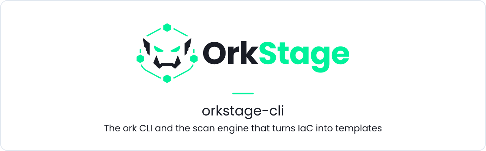
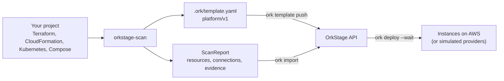

<h1 align="center">
  <picture>
    <source media="(prefers-color-scheme: dark)" srcset=".github/assets/banner-dark.svg">
    <source media="(prefers-color-scheme: light)" srcset=".github/assets/banner-light.svg">
    
  </picture>
</h1>

<p align="center">
  <b>Point <code>ork</code> at an existing project, get an OrkStage environment template, then push, deploy and operate instances from your terminal or CI.</b>
</p>

<p align="center">
  <a href="LICENSE"></a>
  <a href="https://github.com/orkstage/orkstage-cli/actions/workflows/ci.yml"></a>
  <a href="https://orkstage.io/docs/developer/cli"></a>
  
</p>

## What it is

This repository holds two things that share one engine:

- **`ork`**, a single binary for Linux, macOS and Windows. It scans a project, writes a
  `platform/v1` template into `.ork/`, and talks to the OrkStage API to validate and push
  templates, deploy instances, follow deployments, and read status and logs.
- **The scan engine** (`orkstage-scan`), a Rust library that maps Terraform and OpenTofu,
  CloudFormation, SAM, CDK, Kubernetes, Helm, Docker Compose, Dockerfiles and package manifests to
  OrkStage resource types, with evidence for every finding. Compiled to WebAssembly, it is the
  npm package `@orkstage/scan` that the OrkStage API uses for imports.

The scan runs on your machine. `ork import` sends only the resulting report, never your code.



> **Preview.** Commands and flags can still change. There are no released binaries yet; build
> from source as shown below. Signed binaries for every platform are planned.

## Quickstart

Build and install from source (Rust 1.88 or later):

```sh
git clone https://github.com/orkstage/orkstage-cli.git
cd orkstage-cli
cargo install --path crates/ork-cli --locked
ork --version
```

No Rust toolchain? Every build step also runs in Docker; see [docs/building.md](docs/building.md).

Scan a project without an OrkStage server:

```sh
cd my-project
ork scan                     # what was detected, with evidence
ork scan --format json       # the full ScanReport
```

Connect to an OrkStage API (for a local one, see the
[quickstart](https://orkstage.io/docs/get-started/quickstart)) with an API key created in the
console:

```sh
ork login --api-url http://localhost:4000     # prompts for the API key (ork_live_...)
ork init                                      # scans and writes .ork/
ork template validate && ork template push    # creates the template or adds a version
ork deploy --wait                             # deploys the instance named in .ork/config.toml
ork status && ork logs api
```

## Repository layout

| Path | What it is |
|---|---|
| `crates/orkstage-scan` | The scan engine (library, no I/O in its core API, compiles to `wasm32`). |
| `crates/orkstage-scan-wasm` | Bindings generated with `wasm-bindgen`, published as `@orkstage/scan` from `dist/scan-wasm/`. |
| `crates/ork-cli` | The `ork` binary. |
| `docker/` | Toolchain image for building and testing in containers. |
| `docs/` | Reference documentation. |

## Documentation

- [Command reference](docs/reference.md): commands, flags, exit codes, JSON output,
  credentials, the `.ork/` directory, CI usage
- [Scan engine](docs/scan-engine.md): how detection and merging work, the Node.js API,
  dependency choices
- [Building and releasing](docs/building.md): Docker builds, tests, cross compiling, code signing
- [CLI guide on orkstage.io](https://orkstage.io/docs/developer/cli) and
  [importing existing IaC](https://orkstage.io/docs/developer/import)

## Related repositories

| Repository | Role |
|---|---|
| [`orkstage`](https://github.com/orkstage/orkstage) | The control plane: the API this CLI talks to, and the consumer of `@orkstage/scan` |
| [`orkstage-console`](https://github.com/orkstage/orkstage-console) | Web console, where you create API keys and review imports |
| [`orkstage-modules`](https://github.com/orkstage/orkstage-modules) | OpenTofu modules that provision what your templates describe |
| [`orkstage-site`](https://github.com/orkstage/orkstage-site) | orkstage.io and the documentation |
| [`orkstage-dev`](https://github.com/orkstage/orkstage-dev) | Runs the whole stack locally |

## Contributing

Read [CONTRIBUTING.md](.github/CONTRIBUTING.md) for the checks that CI runs and how snapshot
tests work. New detectors need fixtures under `crates/orkstage-scan/tests/fixtures/`.

## Security

Report vulnerabilities privately through
[GitHub Security Advisories](https://github.com/orkstage/orkstage-cli/security/advisories/new) or
to security@orkstage.io. Do not open public issues for them.

## License

[GNU AGPL-3.0](LICENSE) (`AGPL-3.0-only`), part of the OrkStage open core.
