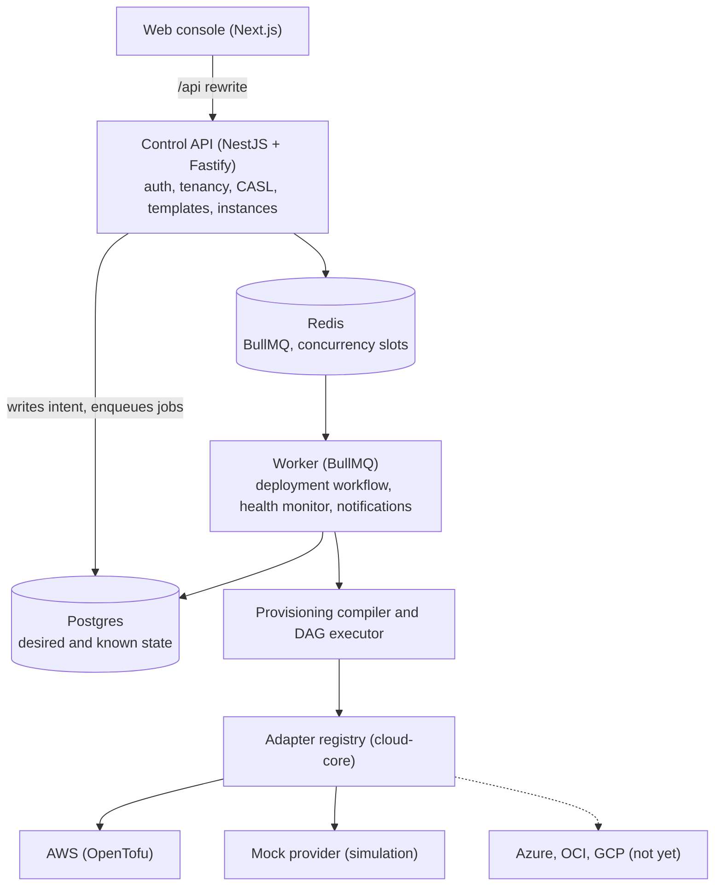

# Architecture

## Layers



The API never runs cloud operations: it records intent and enqueues work for the worker.

The domain packages (`domain`, `templates`, `provisioning`) import no cloud SDK and no
framework. Provider code lives only in the `cloud-*` packages (spec §3, §42.16).

## From template to cloud

```text
Template (provider neutral, versioned)
  + variables  ─▶ applyVariables
  + plan       ─▶ plan compatibility (entitlements)
  + bindings   ─▶ placement slot → cloud target + region      (per resource, not per instance)
               ─▶ capability resolution per resource          (adapter catalog, regional gaps)
               ─▶ names, standard tags, resolved spec, spec hash
               ─▶ dependency DAG (explicit + implicit edges)
               ─▶ connectivity strategy per link              (private / peering / TLS + allowlist)
               ─▶ cost estimate (static catalog pricing, "approximate")
               ─▶ policies (public DB, backups, encryption, regions, budget, multicloud)
= ResolvedInfrastructure ─▶ diff against known resources ─▶ DeploymentPlan (grouped by provider)
```

None of these steps touches a cloud. A deployment stores the `ResolvedInfrastructure` snapshot,
so what was previewed is exactly what gets applied.

### Placement slots

A template declares named slots (`primary`, `data`, `storage`) and the providers each slot
accepts. Each instance binds every slot to one of its cloud targets and a region. Binding all
slots to one AWS target gives the single cloud variant of the same template; binding `data` to
Azure gives a multicloud instance. See [ADR 0001](adr/0001-placement-slots.md).

## Deployment workflow

Steps are created when the deployment is requested, so the console shows the full plan right
away. The worker runs these phases:

```text
deploy:   validate → targets → plan → [approval] → resources (DAG) → rollout → configure
          → verify → observability → finalize
destroy:  validate → backup → plan → resources (reverse DAG) → cleanup → finalize
```

- Each phase and resource step is persisted before and after it runs. When a worker crashes,
  BullMQ redelivers the job (stalled job handling) and it resumes: finished phases are skipped,
  and converged resources (same idempotency key) are not run again.
- A failed resource skips only its dependents; unrelated branches continue, so partial failure
  is an expected outcome. Only transient failure classes are retried, with exponential backoff.
  Destructive operations are never retried automatically.
- Instance status moves through a validated state machine, and every transition is recorded.
- Concurrency: one active deployment per instance (atomic compare and set on the status) and a
  configurable number of slots per cloud target (Redis).

## State: desired, known, actual

The database holds **desired** state (templates, instance configuration) and **known** state
(what OrkStage recorded). Providers hold **actual** state. Every resource row carries a
knowledge state (`DESIRED`, `KNOWN`, `ACTUAL`, `UNKNOWN`) and a drift status. The health monitor
reads actual state again on every tick, and a scheduled job runs refresh only plans on real
providers to flag drift.

## Health, status and incidents

On every health tick the worker checks each active resource through its adapter, rolls health up
to the instance (critical and noncritical components), maps resources to the status components
customers see (API, Workers, Database), and evaluates alert rules stored as data. Incidents are
deduplicated per resource, respect a cooldown, and resolve automatically when health returns.
Notifications go to tenant owners and admins and to platform admins, in the console and by email
(through an outbox).

## Security model (summary)

See [SECURITY.md](SECURITY.md). Opaque session tokens (only the hash is stored), a CSRF header,
CASL checks on every loaded record plus tenant scoping in queries, secrets referenced and never
stored, provider credentials that never reach the browser, and an append only audit log enforced
by a database trigger.
