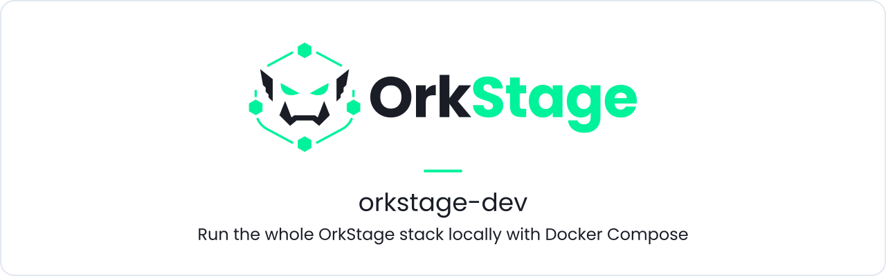
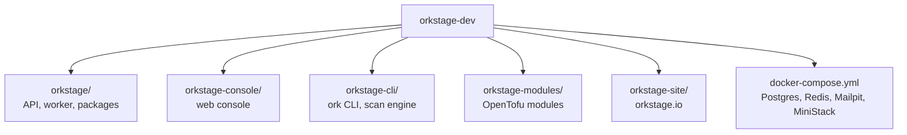

<h1 align="center">
  <picture>
    <source media="(prefers-color-scheme: dark)" srcset=".github/assets/banner-dark.svg">
    <source media="(prefers-color-scheme: light)" srcset=".github/assets/banner-light.svg">
    
  </picture>
</h1>

<p align="center">
  <b>One checkout with every OrkStage repository pinned to a known good commit, plus the Docker Compose stack to run them together on your machine.</b>
</p>

<p align="center">
  
  <a href="https://github.com/orkstage/orkstage-dev/actions/workflows/ci.yml"></a>
  <a href="https://orkstage.io/docs/contributing/development-setup"></a>
</p>

## What it is

OrkStage is split into focused repositories that share code through versioned packages. This
meta repository is where they meet: each one is a git submodule pinned to an exact commit, and
`docker-compose.yml` starts the services they need. Use it to develop across repositories or to
test a combination of versions before a release.



## Quickstart

Requirements: Docker with Compose v2, git, and Node 24+ with pnpm 12 for the applications.

```bash
git clone --recurse-submodules https://github.com/orkstage/orkstage-dev.git
cd orkstage-dev
docker compose up -d --wait                                     # Postgres, Redis, Mailpit
docker compose --profile aws-emulator up -d --wait ministack    # optional: local AWS on :4566
```

Then run the control plane from its submodule (it reads the same ports):

```bash
cd orkstage
cp .env.example .env
pnpm install && pnpm build
pnpm db:deploy && pnpm db:seed
pnpm dev                                                        # API on http://localhost:4000
```

| Service | Address |
|---|---|
| Postgres | `localhost:5432` (user, password and database `platform`) |
| Redis | `localhost:6379` |
| Mailpit | http://localhost:8025 (SMTP on `1025`) |
| MiniStack | http://localhost:4566 |

Stop with `docker compose --profile aws-emulator down` (add `-v` to delete the data).

> **Status.** The `platform` profile in `docker-compose.yml`, which builds and runs the API, the
> worker, the console and the OpenTofu runner as containers, still expects the layout of the
> development monorepo. It will switch to the published images (`ghcr.io/orkstage/platform`,
> `ghcr.io/orkstage/console`, `ghcr.io/orkstage/tofu-runner`) once they exist. Until then, use the
> services above and run the applications from their submodules. A `dev.sh` helper and a
> compatibility matrix (`COMPATIBILITY.md`) are planned.

## Working with submodules

```bash
git submodule update --init --recursive          # after a plain clone
git submodule update --remote orkstage           # move one repository to its latest main
git add orkstage && git commit -m "chore: bump orkstage"
```

Commit a new pin only after the combination works. Each submodule is a normal clone, so you can
branch, commit and open pull requests from inside it.

## Profiles

| Profile | Adds |
|---|---|
| (none) | Postgres, Redis, Mailpit |
| `aws-emulator` | MiniStack, a local AWS emulator that runs real containers for ECS, RDS and ElastiCache |
| `observability` | An OpenTelemetry collector that prints what it receives |
| `platform` | Migrations and seed, API, worker, console and the runner image (see the status note) |

MiniStack and the worker mount the Docker socket, which gives them control of the Docker daemon.
This stack is for local use only.

## Repositories

| Repository | Role |
|---|---|
| [`orkstage`](https://github.com/orkstage/orkstage) | Control API, worker, shared packages |
| [`orkstage-console`](https://github.com/orkstage/orkstage-console) | Web console |
| [`orkstage-cli`](https://github.com/orkstage/orkstage-cli) | `ork` CLI and scan engine |
| [`orkstage-modules`](https://github.com/orkstage/orkstage-modules) | OpenTofu modules and the runner image |
| [`orkstage-site`](https://github.com/orkstage/orkstage-site) | orkstage.io and the documentation |

## Documentation

- [Development setup](https://orkstage.io/docs/contributing/development-setup)
- [Repository map](https://orkstage.io/docs/contributing/repository-map)
- [Run AWS locally with MiniStack](https://orkstage.io/docs/get-started/local-aws)

## Contributing and security

Contributions go to the repository that owns the code; this repository only holds pins and the
local stack. See the [contributing guide](https://github.com/orkstage/.github/blob/main/CONTRIBUTING.md).
Report vulnerabilities privately to security@orkstage.io or through the Security tab of the
affected repository.

## License

MIT for the files in this repository. Each submodule keeps its own license.
