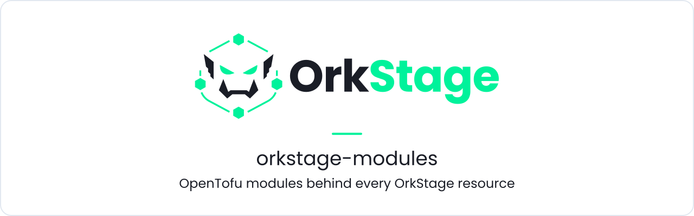
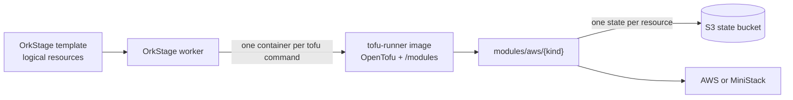

<h1 align="center">
  <picture>
    <source media="(prefers-color-scheme: dark)" srcset=".github/assets/banner-dark.svg">
    <source media="(prefers-color-scheme: light)" srcset=".github/assets/banner-light.svg">
    
  </picture>
</h1>

<p align="center">
  <b>The OpenTofu modules OrkStage uses to provision AWS, one module per logical resource, usable on their own in any OpenTofu or Terraform project.</b>
</p>

<p align="center">
  <a href="LICENSE"></a>
  <a href="https://github.com/orkstage/orkstage-modules/actions/workflows/ci.yml"></a>
  <a href="https://orkstage.io/docs/self-hosting/opentofu"></a>
</p>

## What it is

OrkStage templates describe logical resources (`network`, `database.postgresql`, `ingress`).
When a resource is placed on AWS, the OrkStage worker applies the matching module from this
library, with **one isolated OpenTofu state per resource**, inside a throwaway runner container.
The modules are plain OpenTofu, so you can also use them directly.

- **No secrets in state.** The Postgres master password is generated as an `ephemeral` value and
  written through write only attributes; services receive a Secrets Manager reference.
- **Wired by outputs.** Every module emits a `kind` output, and dependencies flow from one
  module's outputs into the next module's inputs (for example `vpc_id` and `subnet_ids`).
- **Same code locally and on AWS.** Verified against [MiniStack](https://ministack.org), a local
  AWS emulator, and designed for real accounts through a cross account role.

| Module | Logical type | AWS resources |
|---|---|---|
| [`modules/aws/network`](modules/aws/network) | `network` | VPC, public and private subnets across availability zones, internal security group, optional NAT gateway |
| [`modules/aws/container-registry`](modules/aws/container-registry) | `container-registry` | ECR repository with a lifecycle policy, scan on push, immutable tags |
| [`modules/aws/container-service`](modules/aws/container-service) | `compute.container-service` | ECS cluster and service on Fargate, Fargate Spot or EC2 capacity, CloudWatch logs, optional target tracking autoscaling |
| [`modules/aws/postgres`](modules/aws/postgres) | `database.postgresql` | RDS PostgreSQL, subnet group, security group, credentials in Secrets Manager |
| [`modules/aws/redis`](modules/aws/redis) | `cache.redis` | ElastiCache Valkey replication group |
| [`modules/aws/queue`](modules/aws/queue) | `queue` | SQS queue, optional FIFO and dead letter queue |
| [`modules/aws/object-storage`](modules/aws/object-storage) | `object-storage` | Private, encrypted S3 bucket with optional versioning and lifecycle |
| [`modules/aws/ingress`](modules/aws/ingress) | `ingress` | Application Load Balancer with one target group per routed service |
| [`modules/aws/dns`](modules/aws/dns) | `dns` | Route 53 record aliased to the ingress, optional ACM certificate and HTTPS listener |

Azure and OCI modules are planned; in OrkStage those providers are simulated today.



## Quickstart

Use a module from your own OpenTofu configuration. Pin a tag once releases exist; until then
pin a commit SHA.

```hcl
module "network" {
  source = "git::https://github.com/orkstage/orkstage-modules.git//modules/aws/network?ref=<tag or commit>"

  name     = "shop-staging"
  cidr     = "10.40.0.0/16"
  az_count = 2
}

output "private_subnet_ids" {
  value = module.network.private_subnet_ids
}
```

Check a module locally (OpenTofu 1.11 or later; the runner image uses 1.12.7):

```bash
tofu -chdir=modules/aws/network init -backend=false
tofu -chdir=modules/aws/network validate
tofu fmt -check -recursive modules
```

Build the runner image that OrkStage uses (it contains OpenTofu and the modules at `/modules`):

```bash
docker build -f docker/tofu-runner.Dockerfile -t orkstage/tofu-runner:local .
```

In the development monorepo the same Dockerfile is `infra/docker/tofu-runner.Dockerfile`,
built from the repository root.

## Versioning

Releases will be git tags `vX.Y.Z`, each with a matching `ghcr.io/orkstage/tofu-runner:vX.Y.Z`
image. The platform selects one with `TOFU_IMAGE`, so changes to infrastructure code are explicit
upgrades. No release has been tagged yet.

## Related repositories

| Repository | Role |
|---|---|
| [`orkstage`](https://github.com/orkstage/orkstage) | The control plane: compiles templates and runs these modules through the worker |
| [`orkstage-console`](https://github.com/orkstage/orkstage-console) | Web console |
| [`orkstage-cli`](https://github.com/orkstage/orkstage-cli) | `ork` CLI and scan engine |
| [`orkstage-site`](https://github.com/orkstage/orkstage-site) | orkstage.io and the documentation |
| [`orkstage-dev`](https://github.com/orkstage/orkstage-dev) | Runs the whole stack locally |

## Documentation

- [How OrkStage runs OpenTofu](https://orkstage.io/docs/self-hosting/opentofu)
- [Run AWS locally with MiniStack](https://orkstage.io/docs/get-started/local-aws)
- [Connect an AWS account](https://orkstage.io/docs/self-hosting/connect-aws)
- [ADR 0005: OpenTofu execution and state](https://github.com/orkstage/orkstage/blob/main/docs/adr/0005-opentofu-state.md)

## Contributing

Read [CONTRIBUTING.md](.github/CONTRIBUTING.md). In short: keep `tofu fmt` clean, keep every
module valid on its own, never put secrets in variables that end up in state, and keep the
`kind` output.

## Security

Report vulnerabilities privately through
[GitHub Security Advisories](https://github.com/orkstage/orkstage-modules/security/advisories/new)
or to security@orkstage.io.

## License

[Apache-2.0](LICENSE). You can copy these modules into your own infrastructure code.
